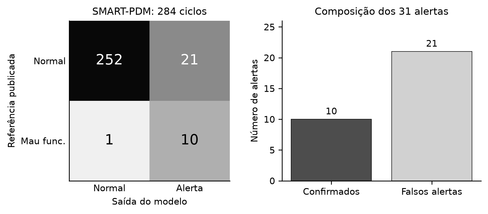

# Detecção de anomalias em refrigeração

## Resultados do Projeto Integrador IV

O projeto analisa registros de um protótipo IoT para monitorar o comportamento
de equipamentos de refrigeração. A Random Forest foi treinada com **1.111
exemplos públicos** de SMART-PDM, NIST e TRI-HP. No teste reservado da SMART-PDM,
sinalizou **10 de 11 ciclos com mau funcionamento** e gerou **21 falsos
alertas entre 273 ciclos normais**.

Nas **3.701 leituras do protótipo do grupo**, as pausas superiores a 60 segundos
formaram 11 grupos. Seis grupos puderam ser pontuados e geraram alertas de
duração atípica. Em um experimento separado, a previsão de temperatura teve
**erro absoluto médio de 0,093 °C em 432 leituras futuras**, de 60 a 80 segundos
após a previsão.



- [Documentação final com treinamento, resultados e painel Metabase](docs/entrega-pi4.md).
- [Contrato, avaliação pública e operação do classificador](docs/cycle-candidate-report.md).
- [Agrupamento temporal das leituras do protótipo](docs/reading-measurements.md).
- [Rodadas de pesquisa e pontes investigadas](docs/research-cycle-2.md).
- [Manifesto do modelo](reports/research/cycle-freeze-8af6bb44817d037a836c/manifest.json).
- [Entradas derivadas de treinamento](reports/research/cycle-freeze-8af6bb44817d037a836c/training-inputs.csv).
- [Métricas do teste público reservado](reports/research/cycle-freeze-8af6bb44817d037a836c/public-test/summary.json).
- SDD **1.4.0**: [spec](specs/001-treinamento-multibase/spec.md),
  [plan](specs/001-treinamento-multibase/plan.md),
  [tasks](specs/001-treinamento-multibase/tasks.md).

O teste público mede a classificação de ciclos com condição de funcionamento
registrada. No protótipo, os alertas descrevem a duração dos trechos de coleta.
As medições do grupo foram reservadas para a aplicação exploratória do
classificador e usadas em um estudo térmico independente.

O MariaDB local contém **19.276 observações públicas, 564.907 valores e 4.875
estatísticas**, com contratos, versões e proveniência. Há 23 tabelas, nove views
e dump estrutural testado. **99.879 escores canônicos de experimentos** estão
materializados para gráficos; não são novas características medidas de treino.
As [11 consultas de pesquisa](database/local/research_queries.sql) passaram com
a conta leitora. Esses números são o snapshot da verificação final desta rodada.

[Preparação do banco](database/local/README.md),
[auditoria local](docs/local-database-audit.md) e
[atribuição das fontes](docs/source-attribution.md) descrevem reprodução e consumo.
O painel do Metabase apresenta os resultados da coleta e do teste público.
O dump versionado contém a estrutura do banco. Os dados privados ficam na
instalação local.

Verificação: **306 testes aprovados, um opt-in legado ignorado**, Ruff e build
Python aprovados. O teste MySQL local usou bases temporárias isoladas.

O [primeiro ensaio negativo](docs/public-feasibility-report.md) permanece
histórico. As seções de backend abaixo descrevem o contrato legado de medições
finalizadas, separado do novo modelo por ciclos.

## Reproduzir a pesquisa pública

Executar a partir da raiz do repositório com as dependências `.[dev,research]`
instaladas e o banco local provisionado. Credenciais ficam no `.env` ignorado.
O registro e a proveniência impedem usar observações externas no desenvolvimento.
Fontes, licenças e alterações estão na [auditoria](docs/public-source-audit.md) e
na [atribuição](docs/source-attribution.md).

```powershell
python -m compressor_anomaly_detection_ml.public_acquisition
python -m compressor_anomaly_detection_ml.public_preparation smart_pdm
python -m compressor_anomaly_detection_ml.public_preparation rwth_r290
python -m compressor_anomaly_detection_ml.public_samples kaist
python -m compressor_anomaly_detection_ml.public_samples ult_freezers
python -m compressor_anomaly_detection_ml.sample_audit kaist
python -m compressor_anomaly_detection_ml.sample_audit ult_freezers
python -c "from compressor_anomaly_detection_ml.public_study import partition_public; print(partition_public()['dataset_version'])"
python -m compressor_anomaly_detection_ml.public_experiments public-study-87d04baa2e265aeb
```

O último comando usa o snapshot existente desta execução; em uma revisão nova,
usar a versão emitida pela etapa de partições. Não refazer partições para procurar
um resultado melhor. Entrada alterada exige uma revisão rastreável; não sobrescrever
artefatos. A repetição de uma execução concluída reaproveita a versão existente.
`public_experiments` avalia a viabilidade e **não publica automaticamente modelo
para inferência**. As Random Forests do piloto permanecem experimentos.

Os gráficos estão nos relatórios e os valores necessários para reconstruí-los
estão nas tabelas/views. A equipe de visualização configura sua ferramenta.
Verificações do primeiro ensaio: 268 testes aprovados, um opcional ignorado,
Ruff/build e restauração estrutural. O fechamento atual está no início deste README.

## Backend atual

Backend Python independente para classificar **medições completas** de um
compressor como normal (`0`) ou anômala (`1`). Usa NumPy/pandas, Random Forest,
joblib e SQLAlchemy/PyMySQL. Python 3.11 ou superior.

```text
ESP32 → API de aquisição → MySQL → ML CLI → resultados no banco → consumo pelos demais integrantes
```

A API de aquisição recebe os pacotes do dispositivo; este projeto consulta o
banco e processa somente coletas explicitamente encerradas. Não oferece API HTTP,
não cria janelas temporais e não treina novamente a cada leitura.

## Situação da integração

A [API de aquisição](docs/integration-audit.md) foi inspecionada no commit
`6e20a97`.
Ele possui uma única tabela `readings`, sem identificador de medição, equipamento,
rótulo ou finalização. O campo `rms` é uma combinação **espacial instantânea** dos
eixos; a unidade `g` ainda precisa de confirmação no firmware. O ML consome os
valores já calibrados pela API, sem repetir offsets ou filtragem.

O adaptador e as tabelas auxiliares `ml_*` estão implementados. Sua implantação
no MySQL e o produtor de medições dependem de revisão e aprovação. Nenhuma
alteração foi aplicada à API ou ao banco compartilhado. A tentativa de acesso
online foi recusada por conta bloqueada. Um backup fornecido em 28/10 confirmou
o esquema e permitiu analisar 3.701 leituras históricas; ele não informa o estado
atual do servidor. Leia [a auditoria](docs/integration-audit.md) e
[a análise do backup](docs/database-dump-audit.md) antes da integração.

## Instalação

No PowerShell, a partir da raiz deste repositório:

```powershell
py -3.11 -m venv .venv
.\.venv\Scripts\python.exe -m pip install -e ".[dev]"
.\.venv\Scripts\python.exe -m compressor_anomaly_detection_ml --help
```

Python 3.12 ou outra versão compatível também pode ser usada. Se preferir `uv`,
use `uv venv --python 3.12` e `uv pip install -e ".[dev]"`.
O comando `compressor-ml` fica disponível ao ativar o ambiente virtual.

## Demonstração local, sem MySQL

```powershell
.\.venv\Scripts\python.exe -m compressor_anomaly_detection_ml demo --database exemplo.sqlite
```

Esse comando exige um arquivo de banco novo. Cria somente um SQLite local com
36 medições **artificiais**, sendo 32 rotuladas, treina `synthetic-v1`, calcula
métricas no holdout, grava uma predição e repete a operação para demonstrar
idempotência (`repeat_created: false`). O modelo fica em
`models/exemplo/synthetic-v1.joblib`. O nome do banco define a subpasta; use outro
nome para outra demonstração. Arquivos SQLite, modelos de demonstração e
credenciais ficam no ambiente local.

Esses dados testam o software. Seus resultados não demonstram detecção de
defeitos reais ou desempenho de campo.

Para consultar e processar a demonstração em outros comandos:

```powershell
$env:ML_DATABASE_URL = "sqlite:///exemplo.sqlite"
$env:MODEL_DIR = "models/exemplo"
.\.venv\Scripts\python.exe -m compressor_anomaly_detection_ml models
.\.venv\Scripts\python.exe -m compressor_anomaly_detection_ml predictions
```

## Configuração MySQL/MariaDB

Copie `.env.example` para `.env` e preencha localmente `DB_HOST`, `DB_PORT`,
`DB_NAME`, `DB_USER` e `DB_PASSWORD`. Não versione o arquivo nem exponha a URL
com senha. Variáveis já definidas no ambiente prevalecem sobre `.env`.
`ML_DATABASE_URL`, quando presente, prevalece sobre os campos `DB_*`; remova a
variável da demonstração antes de usar MySQL.

`MODEL_DIR` define o diretório confiável dos artefatos. O intervalo de consulta é
`POLL_INTERVAL_SECONDS=30` (mínimo 1 segundo). Os parâmetros iniciais são
`RF_N_ESTIMATORS=200`, `RF_RANDOM_STATE=42`, `RF_N_JOBS=-1` e peso `balanced`.
`LOG_LEVEL` controla os logs, emitidos em stderr sem credenciais.

Comece com um usuário de leitura:

```powershell
.\.venv\Scripts\python.exe -m compressor_anomaly_detection_ml check-db
.\.venv\Scripts\python.exe -m compressor_anomaly_detection_ml inspect-contract
```

Ambos executam apenas diagnóstico e consultas de metadados. O código de saída
`2` indica contrato incompleto, mesmo se a conexão funcionar; `1` indica erro.
O relatório mostra colunas, tipos, nulabilidade, chaves, índices e lacunas.
`production_ready` permanece falso: metadados não comprovam unidades, qualidade
de amostragem, imutabilidade ou finalização correta pela aquisição.

`database/000_inspect_read_only.sql` contém consultas adicionais de inspeção.
`database/001_ml_sidecars_proposal.sql` é uma **proposta para revisão**, nunca
executada pela aplicação. Requer comparação com o esquema implantado e aprovação
antes de uso. Ela preserva `readings` e cria somente tabelas auxiliares. A
inicialização automática da aplicação é restrita a SQLite local.

Após aprovação e implantação do contrato, a conta operacional do ML precisa de
SELECT em `readings` e nas tabelas auxiliares, e INSERT/UPDATE nas tabelas de
resultados; não precisa de DDL nem de escrita em `readings`. O produtor de
medições possui permissões separadas para limites, associação e finalização.

## Comandos operacionais

Os exemplos abaixo exigem medições válidas e o contrato auxiliar já preenchido;
para experimentar agora, use a configuração SQLite da demonstração.

```powershell
# Validar e persistir as 20 características de uma medição encerrada.
.\.venv\Scripts\python.exe -m compressor_anomaly_detection_ml extract synthetic-035

# Exportar um CSV consolidado novo; nunca sobrescreve um arquivo existente.
.\.venv\Scripts\python.exe -m compressor_anomaly_detection_ml prepare-data --output treinamento.csv

# Treinar uma versão nova com os rótulos do banco, sem importar CSVs arbitrários.
.\.venv\Scripts\python.exe -m compressor_anomaly_detection_ml train --version rf-v2
.\.venv\Scripts\python.exe -m compressor_anomaly_detection_ml evaluate --model-id 2
.\.venv\Scripts\python.exe -m compressor_anomaly_detection_ml models
.\.venv\Scripts\python.exe -m compressor_anomaly_detection_ml model 2

# Inferência idempotente e consulta dos resultados.
.\.venv\Scripts\python.exe -m compressor_anomaly_detection_ml predict synthetic-035 --model-id 2
.\.venv\Scripts\python.exe -m compressor_anomaly_detection_ml predictions --limit 20
.\.venv\Scripts\python.exe -m compressor_anomaly_detection_ml process-pending --model-id 2 --limit 100

# Consulta periódica, sem novo treinamento; Ctrl+C encerra de forma controlada.
.\.venv\Scripts\python.exe -m compressor_anomaly_detection_ml watch --model-id 2 --limit 100
```

`train` exige ambas as classes, origem independente dos rótulos e `group_id`
explícito, com ao menos dois grupos contendo cada classe. Grupos relacionados
ficam inteiros em treino ou holdout (25%). A escolha dos grupos depende da
campanha de coleta. Uma versão nunca sobrescreve outra.

`evaluate` repete a avaliação no holdout originalmente reservado e rejeita
mudanças nas leituras, rótulos ou grupos. Não avalia as próprias linhas usadas
no ajuste. Métricas e importâncias são persistidas por modelo.

`process-pending` considera finalização, ausência de predição para o modelo
selecionado e ausência de erro registrado para esse par. Medições com erro
ficam separadas para não bloquear as próximas. `predict` permite nova tentativa
explícita. Erros de conexão interrompem o lote e `watch` aguarda o intervalo
configurado antes de tentar novamente. Um modelo novo permite reavaliar as
mesmas coletas, preservando o histórico.

Uma falha global no artefato interrompe o comando antes de processar medições.
Um dado inválido gera erro, nunca uma classificação normal. Escritas relacionadas
a características, predição e conclusão são transacionais; chaves únicas e
bloqueio da medição no MySQL evitam duplicidade persistida em concorrência.
Dois processos ainda podem calcular o mesmo vetor antes de disputar a gravação.

## Modelos e dados

Os artefatos `joblib` contêm o estimador, contrato de sinal, ordem das entradas,
versão, configuração e rastreabilidade. O registro SQL armazena caminho absoluto,
checksum SHA-256, métricas, parâmetros, divisão dos dados e importâncias globais.
O carregamento verifica diretório, checksum, contratos e versão exata do
scikit-learn. Preserve o ambiente Python do treinamento para servir o modelo.

Use apenas artefatos produzidos neste ambiente confiável: `joblib` pode executar
código ao desserializar. Ao mover uma instalação, mova os arquivos e revise os
caminhos registrados. A aplicação não baixa ou publica modelos automaticamente.

As 20 características ficam em JSON acompanhado de nomes ordenados, versão,
contagem e fingerprint das leituras. Essa escolha evita duplicar colunas por
versão; as consultas em `database/metabase_queries.sql` mostram como recuperar
os dados. As probabilidades são estimativas do modelo, sem calibração comprovada.

## Testes

```powershell
.\.venv\Scripts\python.exe -m pytest -q --basetemp=.pytest_cache/local-run
.\.venv\Scripts\python.exe -m ruff check src tests
.\.venv\Scripts\python.exe -m ruff format --check src tests
```

Os testes usam somente dados artificiais e SQLite, sem ESP32 ou banco real.
Cobrem fórmulas, entradas inválidas, splits independentes, métricas, artefatos,
classes/probabilidades, transações, concorrência, versões, CLI e fluxo completo.
O diretório de temporários no projeto também funciona em ambientes restritos.

O teste MySQL é opcional e escreve somente em um banco **vazio e dedicado**,
com nome iniciado por `test_` ou `ml_test_`. Requer `MYSQL_TEST_URL` (definida
localmente sem registrar credenciais) e `MYSQL_TEST_ALLOW_WRITES=1`:

```powershell
.\.venv\Scripts\python.exe -m pytest -m mysql -q --basetemp=.pytest_cache/mysql-run
```

Ele recusa bancos com tabelas existentes, cria suas fixtures, testa persistência
e remove apenas as estruturas criadas nessa execução. Não o aponte para a base
de aquisição. Sem essas variáveis, é pulado. Esse teste não foi executado contra
MySQL durante esta implementação; SQLite não substitui essa validação.

## Organização e documentação

```text
src/compressor_anomaly_detection_ml/
  config.py        ambiente e parâmetros de treinamento
  domain/          entidades tipadas e erros de aplicação
  database/        contrato existente, tabelas auxiliares, repositório e diagnóstico
  features/        validação e extração única das 20 estatísticas
  ml/              dataset, split, treino, métricas, artefatos e inferência
  services.py      casos de uso e processamento de lotes
  cli.py           interface operacional e polling
  demo.py          demonstração sintética restrita a SQLite
tests/             testes unitários, integração local e MySQL opcional
config/            fontes públicas e protocolos de pesquisa
database/          esquema, migrações e consultas de pesquisa
docs/              metodologia, resultados e imagens
examples/          entradas artificiais para testar a interface
models/            classificador treinado com fontes públicas e manifesto em reports/
reports/research/  evidências selecionadas de treino e avaliação pública
scripts/           experimentos reproduzíveis e configuração local do painel
specs/             especificação, plano e tarefas
```

- [Auditoria de integração](docs/integration-audit.md)
- [Análise do backup e das leituras históricas](docs/database-dump-audit.md)
- [Arquitetura e contrato de finalização](docs/architecture.md)
- [Metodologia de ML](docs/ml-methodology.md)
- [Relatório da implementação](docs/implementation-report.md)

O caminho para dados reais é confirmar unidades e amostragem com o firmware,
inspecionar o MySQL implantado, aprovar as tabelas auxiliares e implementar um
produtor confiável que associe IDs e finalize a coleta após persistir as leituras.
Depois, reunir medições rotuladas e grupos independentes e validar no MySQL
isolado antes da execução compartilhada. Não há evidência de eficácia em campo
até realizar essa avaliação.
