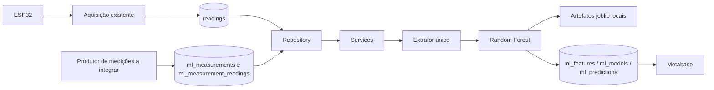

# Arquitetura

O banco é o ponto de integração dos backends independentes. A aquisição mantém
`readings`; o ML lê essas amostras e grava suas próprias características,
modelos, importâncias, predições e estados de processamento. Nenhum componente
deste projeto recebe pacotes do ESP32.

O produtor no diagrama é uma dependência de integração proposta, ainda não
implementada na API. Seus nomes de tabela não representam estruturas confirmadas
no banco real. Veja a auditoria e o SQL revisável antes de implantar.

## Contrato de uma coleta

Uma medição informa identidade estável, equipamento, grupo de correlação,
instantes de início/fim em UTC, contagem exata de leituras e sua associação
explícita por IDs. A unidade de aceleração deve estar confirmada como `g` e a
definição do sinal deve ser `api-calibrated-spatial-rms-v1`. Rótulo e origem
independente são opcionais para inferência e obrigatórios para treinamento.

O produtor deve criar uma medição `ABERTA`, associar apenas as leituras
efetivamente pertencentes à coleta e finalizar depois de todos os INSERTs terem
sido confirmados. A mudança para `FINALIZADA`, o instante final, a contagem e os
vínculos devem ser publicados de forma consistente. Leituras e limites tornam-se
imutáveis após esse ponto. Os IDs de leituras não podem pertencer a duas medições.

O ML não implementa esse produtor, não reconstrói medições históricas e não
supõe janelas por horário, IDs consecutivos ou 15 segundos. Alterar a aquisição
para fornecer o contrato exige revisão com o responsável, incluindo impactos
sobre o firmware. Um coordenador externo só é válido se conhecer confiavelmente
o ciclo e os IDs gravados; consultar intervalos arbitrários não resolve a lacuna.

Os horários atuais de `readings` representam inserção no MySQL, com precisão de
segundos. Empates são permitidos; a ordenação usa timestamp e ID. As conexões
MySQL configuram o fuso da sessão como UTC, permitindo converter `TIMESTAMP`
para datetimes conscientes de fuso no domínio. Isso não recupera um horário de
captura ou frequência que o firmware não tenha informado.

## Módulos

`domain` define `Reading`, `Measurement`, `FeatureVector`, `PredictionResult` e
os erros esperados. O extrator exige todos os campos e calcula estatísticas sem
SQL ou dependência do classificador. A versão do processamento e os 20 nomes
ordenados ficam centralizados nesse contrato.

`database` adapta `temperature/rms/accel_x/accel_y/accel_z` aos nomes do domínio,
sem recalibrar ou modificar a semântica. SQLAlchemy descreve `readings` para
consulta e resolução de chaves estrangeiras; isso não autoriza sua criação em
produção. Helpers de criação e ingestão sintética recusam qualquer dialeto
diferente de SQLite.

`ml` prepara o dataset com o extrator comum, realiza holdout agrupado, treina a
Random Forest e avalia no conjunto reservado. Arquivos de artefato são publicados
sem substituir versões existentes e verificados contra seu registro SQL.

`services` orquestra extração, exportação, treinamento, inferência e lotes. A CLI
seleciona o caso de uso, carrega o ambiente e emite JSON em stdout e logs em
stderr. O polling utiliza lotes limitados, aguarda entre iterações e permite
encerramento por SIGINT/SIGTERM.

## Estruturas auxiliares propostas

| Tabela | Responsabilidade e chave |
| --- | --- |
| `ml_measurements` | Coleta explícita, chave `measurement_id`; finalização pela aquisição/coordenador |
| `ml_measurement_readings` | Associação da coleta às amostras existentes, `reading_id` único |
| `ml_features` | Vetor e fingerprint; chave `(measurement_id, processing_version)` |
| `ml_models` | Registro JSON e artefato; unicidade `(name, version)` |
| `ml_feature_importances` | Importância global; chave `(model_id, feature_name)` |
| `ml_predictions` | Resultado histórico; unicidade `(measurement_id, model_id)` e FK ao vetor |
| `ml_processing_runs` | Conclusão ou erro por `(measurement_id, model_id)` |

Os estados `PROCESSADA` e `ERRO` pertencem à execução de um modelo. A medição
permanece `FINALIZADA`, permitindo inferência por novas versões. A seleção de
pendências consulta predições e erros por modelo; um status global não elimina
o direito de reavaliar uma coleta.

As 20 características são armazenadas como um array JSON e lista ordenada de
nomes, em vez de colunas repetidas por versão. Parâmetros, métricas e manifesto
do treinamento ficam em JSON no registro do modelo. IDs, versões, chaves,
probabilidades, datas e importâncias ficam indexáveis em colunas próprias.
Consultas documentadas preservam separação entre pendentes, erros e classificadas,
filtram uma versão de modelo e não contam reprocessamentos como novas coletas.

## Consistência, falhas e concorrência

Uma transação grava vetor, predição e conclusão. O MySQL bloqueia o registro de
medição durante a conclusão, e as chaves únicas protegem execuções concorrentes.
O cálculo anterior ao bloqueio pode ser repetido, mas apenas uma predição é
persistida para o par. Conflitos de unicidade são tratados em novas transações.

O fingerprint cobre IDs, amostras ordenadas, limites, contagem, equipamento,
unidade e versão do sinal/processamento. Uma versão de características já
persistida não é sobrescrita se esses dados mudarem. Essa detecção complementa
o contrato obrigatório de imutabilidade após finalização; o backend não bloqueia
um produtor externo que viole esse contrato durante uma leitura inicial.

Erros de validação são registrados separadamente, sem predição. Medições com
erro saem da seleção periódica; `predict` realiza uma tentativa explícita. Se o
banco ficar indisponível, o lote é interrompido e o polling aguarda. A falha ao
gravar um erro preserva a exceção original. Um artefato ausente ou incompatível
é um erro global antes de iniciar o lote.

Arquivo de modelo e banco não compartilham transação distribuída. O treinamento
salva um arquivo novo completo e então registra metadados/importâncias em uma
transação SQL; se esse registro falha, uma consulta confirma a ausência do registro
antes de remover o arquivo recém-criado. Se não for possível consultar o banco,
o arquivo é preservado: a falha pode ter ocorrido depois do commit no servidor.
Uma interrupção abrupta entre as duas etapas pode deixar um artefato órfão.
Inspecione o registro e o diretório antes de limpar ou tentar reutilizar a versão.
Nunca substitua silenciosamente um arquivo publicado.

Os testes locais verificam transações, chaves, concorrência e fluxo usando SQLite.
Existe teste MySQL opcional, restrito a banco vazio explicitamente habilitado.
As diferenças de driver, SQL, precisão e bloqueios precisam dessa validação
antes da implantação. Nenhum teste foi executado contra a base compartilhada.
