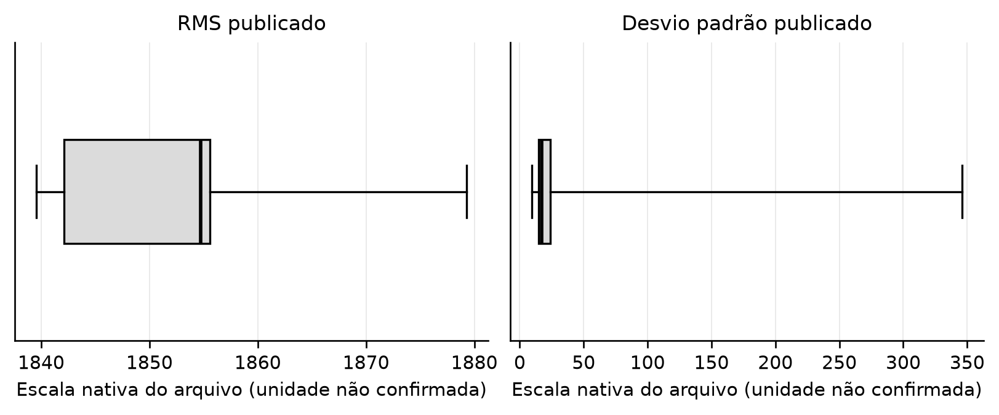
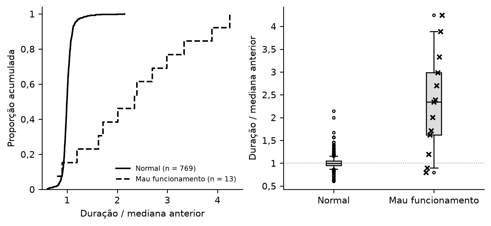
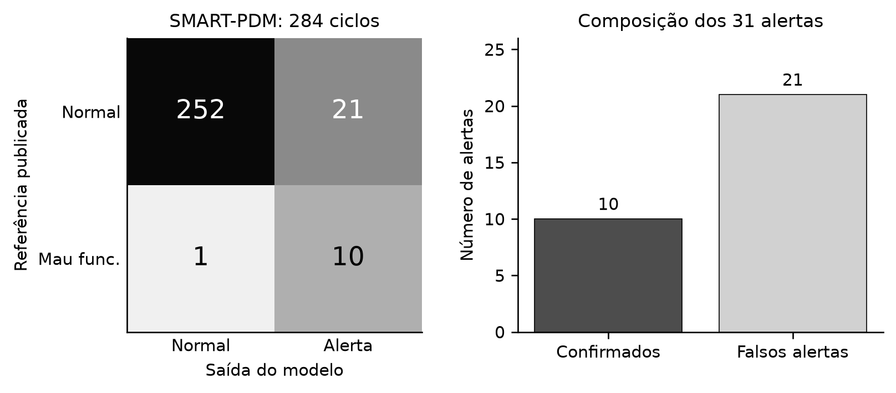
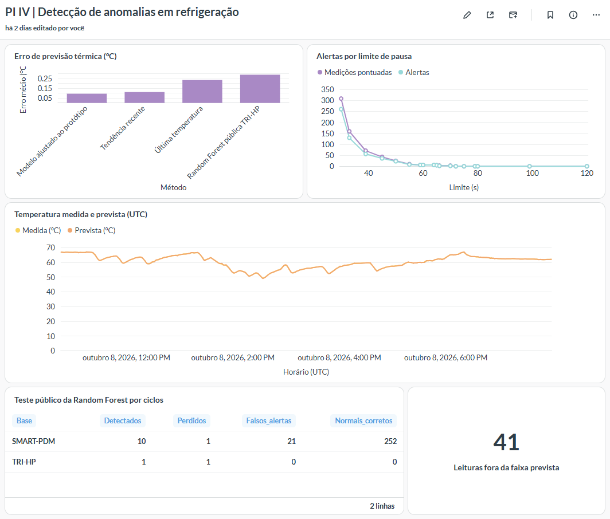

# Treinamento e resultados do Projeto Integrador IV

O protótipo do grupo registrou temperatura e aceleração em três eixos em uma
geladeira doméstica. O trabalho treinou uma Random Forest para sinalizar
comportamentos atípicos, aplicou-a aos grupos de leituras do protótipo e avaliou
separadamente uma previsão de temperatura para cerca de um minuto à frente.

## Por que o treinamento mudou

A coleta do protótipo registrava o horário de cada leitura. Os registros não
marcavam o início e o fim da operação nem a condição do compressor em cada
período. As fontes públicas forneceram os exemplos rotulados para o
treinamento supervisionado.

| Fonte | Exemplos de treinamento | Informação aproveitada |
| --- | ---: | --- |
| [SMART-PDM](https://doi.org/10.5281/zenodo.7245198) | 782 | Duração dos ciclos de geladeiras em relação ao histórico e condição informada por técnicos |
| [NIST](https://www.nist.gov/el/beed/hvacr-equipment-performance-group/fault-detection-and-diagnosis-research-data) | 294 | Temperatura e vazão em ensaios de refrigeração com condições documentadas |
| [TRI-HP](https://doi.org/10.5281/zenodo.5155136) | 35 | Temperatura e vazão em condições experimentais de uma bomba de calor |
| **Total** | **1.111** | Quatro descritores estatísticos comuns |

Os resumos de vibração mostraram sobreposição entre as classes na SMART-PDM.
A figura ilustra essa sobreposição em duas características. Os experimentos
com duração relativa identificaram melhor os casos rotulados nessa base.
[Análise exploratória e primeiros experimentos](public-feasibility-report.md).



Para cada ciclo completo da SMART-PDM, dividimos sua duração pela mediana
de até dez ciclos anteriores do mesmo grupo, com pelo menos três anteriores.
Se a mediana era de 10 minutos e o ciclo atual durou 18, sua duração relativa
era 1,8. NIST e TRI-HP contribuíram com grandezas térmicas e de vazão. Cada
fonte teve sua própria referência de normalidade.



## Como a Random Forest foi treinada

1. Os exemplos normais de cada fonte definiram referências de normalidade.
   Durante o desenvolvimento, os grupos avaliados ficaram fora do ajuste
   das respectivas referências.
2. Cada observação foi resumida em quatro valores: raridade média, maior
   raridade, fração de características raras e percentil da Isolation Forest.
   A Isolation Forest forneceu uma medida de raridade diante da referência.
3. A Random Forest recebeu esses valores e os rótulos originais das fontes.
   Os pesos equilibraram as classes dentro de cada fonte. O limiar de alerta
   foi fixado em 0,5 no escore bruto antes do teste reservado.

O trecho abaixo está no [código do classificador](../src/compressor_anomaly_detection_ml/temporal_confirmation.py#L37-L63).

```python
model = RandomForestClassifier(
    n_estimators=protocol["classifier"]["n_estimators"],
    max_depth=protocol["classifier"]["max_depth"],
    min_samples_leaf=variant["leaf"],
    random_state=protocol["classifier"]["seed"],
    n_jobs=1,
)
return model.fit(fit[META_NAMES], fit.target_label.astype(int), sample_weight=weights)
```

O [protocolo](../config/cycle-candidate-freeze.json) registra a configuração
final de 200 árvores, profundidade máxima 5, mínimo de 10 casos por folha
e semente 2026. A implementação está em
[`transfer_novelty.py`](../src/compressor_anomaly_detection_ml/transfer_novelty.py),
[`cycle_candidate.py`](../src/compressor_anomaly_detection_ml/cycle_candidate.py)
e no [script que registra o treinamento](../scripts/freeze_cycle_candidate.py).
O [CSV de treinamento](../reports/research/cycle-freeze-8af6bb44817d037a836c/training-inputs.csv)
contém as entradas derivadas e a origem de cada caso. Nas linhas da SMART-PDM,
o CSV guarda a duração relativa usada para gerar os descritores durante o
treinamento. Nas linhas do NIST e da TRI-HP, guarda os descritores já calculados.
O [manifesto](../reports/research/cycle-freeze-8af6bb44817d037a836c/manifest.json)
identifica os arquivos e seus hashes. As condições experimentais das três fontes
têm significados próprios, descritos na [atribuição dos dados](source-attribution.md).

## Teste público e aplicação às medições do grupo

No teste reservado da SMART-PDM, o classificador sinalizou **10 de 11 ciclos
com mau funcionamento**. Entre os **273 ciclos normais**, houve **21 falsos
alertas**. Nove ciclos ficaram sem contexto suficiente para pontuação.
Na TRI-HP, o modelo sinalizou uma de duas condições de excesso de refrigerante.
Veja as [métricas por fonte](../reports/research/cycle-freeze-8af6bb44817d037a836c/public-test/summary.json)
e as [predições públicas](../reports/research/cycle-freeze-8af6bb44817d037a836c/public-test/predictions.csv).



Com as **3.701 leituras do protótipo**, uma pausa superior a 60 segundos entre
registros delimitou cada novo grupo. O procedimento formou 11 grupos, dos
quais seis puderam ser pontuados. Os seis alertas sinalizaram durações
atípicas nos trechos de coleta. As métricas de detecção de mau funcionamento
referem-se ao teste público rotulado. A
[análise de 18 limites](reading-measurements.md#ensaio-histórico) mostra a
influência da escolha do intervalo sobre os alertas.

## Previsão de temperatura e painel

O experimento térmico estimou a leitura do sensor de 60 a 80 segundos à
frente. O modelo final de regressão por árvores sequenciais aprendeu com a
parte inicial da coleta do protótipo. As **432 previsões** foram avaliadas
contra as temperaturas medidas depois, no mesmo dia.

| Método | Erro absoluto médio |
| --- | ---: |
| Última temperatura medida | 0,232 °C |
| Prolongamento da tendência recente | 0,110 °C |
| Random Forest treinada com dados térmicos da TRI-HP | 0,286 °C |
| Modelo térmico ajustado às medições do protótipo | **0,093 °C** |

O erro do modelo ajustado foi cerca de 15% menor que o da tendência recente.
Quarenta e uma leituras ficaram fora da faixa prevista. A mesma parte
posterior da coleta foi usada nas duas rodadas retrospectivas. Os scripts
registram a [transferência térmica](../scripts/evaluate_temperature_transfer.py),
o [ajuste cronológico](../scripts/evaluate_temperature_adaptation.py) e o
[reprocessamento dos alertas](../scripts/evaluate_telemetry_replay.py).
Os [resultados agregados](../reports/resultado-pi4.json) incluem as métricas
com precisão completa.



## Executar o classificador

Na raiz do projeto, com Python 3.11 ou superior, instale o pacote com a versão
do scikit-learn usada pelo artefato publicado.

```text
python -m pip install -e . "scikit-learn==1.9.1"
```

O comando abaixo carrega o [artefato versionado](../models/cycle-freeze-8af6bb44817d037a836c.joblib)
e pontua uma [entrada artificial](../examples/completed-cycles.fixture.json),
sem conexão com o banco.

```powershell
$env:ML_DATABASE_URL = "sqlite://"
python -m compressor_anomaly_detection_ml predict-cycles --manifest reports/research/cycle-freeze-8af6bb44817d037a836c/manifest.json --cycles examples/completed-cycles.fixture.json
```

A URL SQLite preenche a configuração da interface. A demonstração lê apenas
o manifesto, o modelo e o JSON de exemplo.

Para reconstruir o treinamento, use o [registro de fontes](../config/dataset-sources.json)
e os [passos de pesquisa pública](../README.md#reproduzir-a-pesquisa-pública).
O script usa as [partições originais](../reports/research/public-study-87d04baa2e265aeb/partitions.csv),
os [descritores auxiliares](../reports/research/temporal-round7-c2f700026e1cc1c77edd/auxiliary-normality-experiments.csv),
os [escores da confirmação](../reports/research/temporal-round8-9492770bdefcfd8c0fcd/predictions.csv)
e o banco de pesquisa provisionado. O [relatório das rodadas](research-cycle-2.md)
documenta a ordem dos experimentos. O teste reservado publicado é o resultado
daquela execução.

O [esquema do MariaDB](../database/local/README.md) e as
[consultas de pesquisa](../database/local/research_queries.sql) acompanham o
projeto. A reconstrução do painel da coleta requer as saídas locais dos
experimentos com as medições do protótipo. Com essas saídas e uma instância
local configurada, os scripts de [inicialização](../scripts/start_delivery_metabase.ps1)
e [provisionamento](../scripts/provision_delivery_metabase.py) montam o painel.
