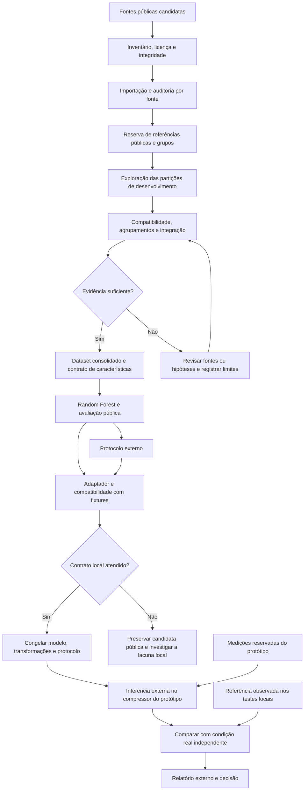

# Plano técnico — treinamento multibase e validação externa

Versão: 1.4.0
Data: 01/11/2026
Estado: candidata pública multibase congelada; integração externa condicionada a ciclos reais
Contrato: [spec.md](spec.md)
Execução: [tasks.md](tasks.md)

Primeiro ensaio preservado: `public-study-87d04baa2e265aeb-eda-737cd888`.
Seu [relatório](../../docs/public-feasibility-report.md) é histórico. A versão
1.3.0 reabre T07–T14 e acrescenta T29–T31. O próximo ciclo procura relações
transferíveis e uma base consolidada confiável, mantendo a Random Forest e a
aplicação posterior no compressor de geladeira. Atipicidade é ferramenta auxiliar.

## 0. Candidata pública implementada nesta revisão

A trilha pública cumpriu os critérios de discriminação e produziu
`cycle-freeze-8af6bb44817d037a836c`, com dataset
`cycle-reference-8af6bb44817d037a836c`. O contrato
`cycle-context-normality-v1` usa ciclos concluídos, não o vetor legado de
temperatura/vibração. A portabilidade local permanece pendente; RF-47–RF-50
impedem tratar essa mudança como integração automática com a API existente.

Sequência técnica efetivamente implementada:

1. Auditar fontes adicionais e sinais brutos; ampliar características
   publicadas, espectrais e térmicas; testar pontes RWTH, controles de regime,
   transferência por proxy e referências auxiliares sem usar dados locais.
2. Comparar descritores de normalidade com cross-fitting por grupo e testar
   duração relativa a histórico causal de ciclos. Isolation Forest apenas
   prepara quatro entradas para a Random Forest supervisionada.
3. Confirmar o efeito de fontes com ablação, rótulos auxiliares embaralhados
   e limiar/calibração ajustados dentro do treino. A candidata foi escolhida
   entre configurações públicas, antes de abrir o teste reservado.
4. Congelar entradas, contrato, referências e pipeline. Persistir casos,
   características, dataset e modelo no MariaDB sem alterar a aquisição.
5. Executar uma única avaliação nos 293 ciclos SMART e no dia TRI OC
   reservados. Manter os resultados e considerar essas reservas consumidas.
6. Disponibilizar `predict-cycles` para entrada com limites comprovados e
   histórico. Hash, versão e contrato são verificados. Essa CLI de pesquisa
   retorna JSON; não substitui a campanha externa e sua persistência futura.
7. Confirmar a captura local dos limites reais; só então concluir adaptador,
   integração externa e congelamento específico da campanha. Não abrir
   leituras locais para escolher características ou ajustar o modelo.

Implementação: `transfer_temporal.py`, `transfer_novelty.py`,
`temporal_confirmation.py`, `cycle_candidate.py` e CLI. O cálculo causal é
compartilhado entre treinamento e inferência; artefatos legados continuam
com seu contrato próprio. Não foi adicionado framework ou segundo SGBD.

Protocolos: `transfer-round7-temporal.json`,
`transfer-round8-confirmation.json`, `cycle-candidate-freeze.json` e
`external-cycle-protocol.json`. As execuções preservam os protocolos usados;
alterações posteriores não reescrevem histórico nem convertem teste consumido
em nova evidência independente.

Scripts: `run_novelty_round6.py config/transfer-round7-temporal.json`,
`run_temporal_confirmation.py`, `freeze_cycle_candidate.py`,
`evaluate_cycle_candidate.py <manifesto>`,
`materialize_research_predictions.py`, `finalize_research_handoff.py`.
Os scripts usam as entradas e manifestos locais auditados; a documentação
das fontes informa os provedores e hashes. Executá-los com código/entradas
alterados gera novas versões, não autorização para retestar a reserva consumida.

O [relatório da candidata](../../docs/cycle-candidate-report.md) é a evidência
atual. O primeiro ensaio negativo e as demais rodadas continuam preservados.

## 1. Objetivo técnico e ordem das decisões

Implementar uma trilha reprodutível que transforme fontes públicas heterogêneas em um dataset de desenvolvimento consolidado, quando houver suporte científico para isso, treine uma Random Forest com entradas utilizáveis na aplicação e reserve as medições do protótipo para teste externo.

A primeira entrega experimental será uma conclusão documentada sobre a integração das fontes. O treinamento final dependerá dessa conclusão e do congelamento do dataset. A SMART-PDM não será escolhida antecipadamente como única base final; a participação das demais fontes será investigada e contabilizada.

O plano usa a stack existente: Python, NumPy, pandas, scikit-learn, joblib, SQLAlchemy/PyMySQL e a CLI já disponível. O MariaDB local será o repositório relacional dos dados preparados e resultados auditáveis; CSV/JSON permanecem como intercâmbio, manifestos e reprodução. Não será criado um serviço HTTP ou framework de orquestração para executar essa trilha.

O usuário autorizou executar a revisão e os ciclos seguintes autonomamente.
Hipóteses reprovadas alimentam investigação adicional e busca dirigida, sem
pedir aprovação rotineira para limpeza, experimentos reversíveis ou aquisição
pública necessária. A entrega imediata pretendida é a Random Forest avaliada
publicamente, com contrato e software para receber leituras externas; a campanha
física T22/T23 exige posteriormente observação real e não pode ser simulada como
concluída. Não reduzir o objetivo para detector isolado ou modelo apenas de bancada.

## 2. Arquitetura do fluxo proposto

Antes da ingestão, executar T25 (banco/esquema), T27 (views) e T28 (dump/restauração). T01 passa a usar essa infraestrutura. T26 integra a persistência de pesquisa antes de T02. Essa ordem respeita a solicitação posterior do usuário, sem renumerar os IDs existentes.



O retorno da pesquisa deve produzir hipóteses e evidências novas. Uma ligação
inviável gera relatório e próxima rota/busca; não encerra automaticamente o
objetivo enquanto houver alternativas investigáveis. A seta de retorno não
autoriza consumir o teste externo para resolver a integração pública.

Na revisão 1.3.0, uma rodada negativa não encerra o trabalho enquanto houver
caminho público viável a investigar: atualizar a matriz de hipóteses, procurar
fontes ligadas à lacuna, executar o próximo experimento e verificar o aceite.
Repetir os mesmos parâmetros ou fabricar uma equivalência não constitui avanço.
Separar a decisão de viabilidade pública de T14 da prontidão local de T20.
T15–T17 podem produzir uma candidata pública; somente contrato local atendido,
protocolo e congelamento permitem abrir o teste externo.

### 2.1. Separação dos dados e artefatos

Estrutura proposta, a criar nas tarefas de implementação:

```text
data/
  public/
    raw/<source_id>/<source_version>/
    canonical/<source_id>/<source_version>/
    consolidated/<dataset_version>/
  external/
    ulisses/<campaign_id>/
reports/
  research/<run_id>/
  external/<campaign_id>/<model_version>/
models/
  <model_version>/
```

Essa árvore descreve destinos futuros de arquivos. Metadados, exemplos preparados, valores de características, rótulos e resultados tabulares também devem ser persistidos no MariaDB; diretórios não substituem esse registro. Os arquivos grandes, dados externos privados e artefatos binários não serão versionados no Git. Configurações, dicionários, código e relatórios textuais sem conteúdo privado poderão ser versionados. O manifesto deve permitir reproduzir a aquisição pública mesmo quando os arquivos locais estiverem ausentes.

A separação por diretório ajuda a operação, mas não é a proteção principal: toda observação deve carregar origem verificável. O validador de desenvolvimento deve rejeitar `data_origin=ulisses_external`, registros sem origem e derivações que incluam esses registros, mesmo que estejam copiados para outra pasta.

### 2.2. Arquivos de controle mínimos

| Artefato proposto | Conteúdo |
| --- | --- |
| `sources.json` | Registro das fontes, versões, licença, URLs, arquivos, hashes e estado da auditoria |
| `observations.csv` | Identidades, grupos, sinais/características normalizados e metadados de proveniência |
| `labels.csv` | Rótulos originais, alvo, status de referência/derivado/indeterminado e evidência |
| `quality.json` | Contagens, falhas, exclusões, conversões e unidades desconhecidas |
| `partitions.csv` | Observação, grupo, origem e partição reservada; versão/hash |
| `feature-contract.json` | Ordem, significado e requisitos de cada entrada do modelo |
| `integration.json` | Método, hipóteses, experimentos, sensibilidade, evidências e decisões de integração |
| `training-manifest.json` | Dataset final, composição, hashes, partições e configuração |
| `metrics.json` | Resultados públicos ou externos identificados pelo respectivo nível de avaliação |
| `external-protocol.json` | Procedimento de teste, referência real, critérios de sucesso e congelamento |
| `transfer-protocol.json` | Hipóteses, reservas, comparações, limites de suporte e regra de continuidade da rodada 1.3 |
| `source-relations.json` | Nós/arestas/caminhos de sinais e fontes; associação medida, transformação estimada ou hipótese |
| `bridge-validation.json` | Ajuste e avaliação agrupada das pontes, erros, incerteza e limites de extrapolação |
| `calibration.json` | Escopo da probabilidade, partições, método, confiabilidade e suporte/insuficiência |

Arquivos podem ser reunidos quando isso reduzir duplicação sem perder rastreabilidade. Seus registros auditáveis serão armazenados nas tabelas `study_*`, com hashes e vínculos. Não introduzir abstrações genéricas de plugin.

### 2.3. Banco local e disponibilização de dados — versões 1.1.0 e 1.2.0

Foi encontrado MariaDB 10.4.24 ativo pelo XAMPP, além de PostgreSQL 17. Escolha: MariaDB em loopback, para reusar driver e dialeto do projeto. Criar `compressor_ml_dev` somente se o nome ainda não existir. A inicialização não altera banco ou conta existentes.

O provisionamento explícito fica em `database/local_setup.py`, separado da inicialização da aplicação. Aplicar, apenas no banco novo: cópia estrutural da aquisição, tabelas auxiliares legadas, tabelas de pesquisa e views `mb_*`. Registrar a versão aplicada. Manter contas locais próprias para aplicação e consumo de leitura, com segredos em `.env` ignorado pelo Git; não gravar credencial administrativa. Os nomes existentes `mb_*` e da conta leitora são preservados, sem exigir desenvolvimento específico para o Metabase.

A conta do ML tem SELECT na estrutura e INSERT/UPDATE nas entidades necessárias, sem DDL e sem escrita em `readings`. A conta de consumo tem somente SELECT no banco do projeto. Dados de conexão e credenciais devem ser entregues aos responsáveis por canal apropriado, sem versionar segredos.

Os escritores da pesquisa devem realizar transações por unidade coerente: fonte/arquivo, lote preparado, resultado de execução ou snapshot de dataset. IDs, versões e chaves únicas sustentam repetibilidade. Falha de escrita impede marcar a etapa como persistida/concluída; preservar a causa e permitir retomada sem duplicar registros. Não usar o banco compartilhado como ambiente de testes.

As views devem permitir inventário/qualidade, séries e distribuições de características, rótulos por versão, estatísticas e correlações, grupos, composição/partições, métricas públicas e teste externo. As consultas de avaliação devem filtrar campanha, modelo e versão da referência, separar recusas/indeterminados e evitar multiplicação por revisões de rótulos.

Versionar `database/local/schema.sql`, exportado sem dados/contas por `mysqldump --no-data`. Remover definers específicos e qualificações do banco original das views para permitir restauração em outro banco vazio. Verificar em um banco temporário criado exclusivamente para esse teste, comparando tabelas, colunas, índices, FKs, CHECKs e views; conferir ausência de linhas e executar as views. Remover apenas o banco temporário criado nessa execução.

Nossa entrega é o banco preenchido pelas etapas de pesquisa/ML, o dump estrutural, o dicionário, as regras de consulta e o acesso de leitura. Os demais integrantes são responsáveis por usar esses dados no Metabase. Não executar instalação, conexão, configuração, criação de perguntas/gráficos/dashboards ou operação do Metabase. Nenhuma dessas atividades é dependência de conclusão do pipeline de ML. Gráficos exploratórios internos podem apoiar a pesquisa, sem obrigação de entregar uma interface de visualização.

## 3. Impacto no código existente

O backend atual prepara treinamento a partir de `Measurement`, usa um extrator fixo de 20 características e exige um contrato que ainda não existe na aquisição. O pipeline público deve separar a origem dos dados do ato de ajustar e avaliar o estimador.

| Local existente | Reuso e mudança planejada | Chamadores/verificações afetados |
| --- | --- | --- |
| `domain/entities.py` | Preservar contratos antigos e introduzir a representação tabular/versionada necessária sem inventar coletas `FINALIZADA` para acomodar arquivos públicos | Extrator, treinamento, inferência, artefatos e respectivos testes |
| `features/extraction.py` | Reusar fórmulas somente quando significado, taxa e unidade coincidirem; definir um caminho compartilhado de características para treino e aplicação do novo modelo | `ml/training.py`, `ml/inference.py`, serviços e fixtures |
| `ml/training.py` | Adaptar `TrainingDataset`, avaliação e treinamento para o contrato multibase, grupos e rótulos de diferentes status; não depender de consultar o banco do protótipo | `services.py`, `cli.py`, testes de ML e de fluxo |
| `ml/artifacts.py` | Preservar checksum e origem confiável; versionar formato e contrato, atualmente ligados a constantes globais de 20 entradas | Carregamento, predição, testes de corrupção e compatibilidade |
| `ml/inference.py` | Validar contrato do modelo e transformações persistidas, com resultado explícito para entrada incompatível | Serviço, CLI, armazenamento e testes de inferência |
| `services.py` e `cli.py` | Expor preparação pública, pesquisa, treinamento e teste externo por caminhos explícitos; nenhuma origem local implícita no comando de treino público | Testes de CLI e serviço, documentação de comandos |
| `database/repository.py`, `models.py`, `connection.py` | Reusar leitura e persistência local compatíveis; não exigir migração compartilhada para pesquisar ou avaliar exportações | Testes locais e MySQL isolado quando houver mudança específica |
| `config.py`, `pyproject.toml`, `.gitignore` | Centralizar caminhos, versões, sementes e dependências realmente necessárias; ignorar dados e modelos locais | Testes de configuração, instalação e comandos |
| `README.md` e `docs/` | Distinguir fluxo antigo implementado, novo contrato SDD e estado real dos resultados | Links, exemplos e correspondência com a CLI |
| `tests/` | Fixtures pequenas e artificiais para contratos e erros; avaliações científicas reais ficam em relatórios separados | Testes unitários, integração local e regressões afetadas |

Na primeira implementação de importação, um módulo `datasets.py` com funções pequenas e específicas por fonte é suficiente. Separar em submódulos somente se o código efetivamente crescer. Usar um módulo `research.py` para a análise e um módulo `external_validation.py` para o fluxo reservado, caso esses comportamentos não caibam de forma clara nos módulos existentes. Esses nomes são destinos de implementação propostos, não arquivos já presentes.

Não transformar `prepare_dataset()` em um adaptador que atribui equipamento, unidade física, ciclo ou finalização fictícios aos dados públicos. Tampouco remover as verificações de contrato dos modelos antigos para aceitar o novo dataset. Nova semântica deve ter nova versão e testes próprios.

## 4. Etapa 1 — inventário e importação pública

Requisitos: RF-01 a RF-06, RF-30, RF-32.
Tarefas: T01 a T06.

### 4.1. Registro e aquisição

1. Registrar as fontes de `spec.md`, seus estados de inspeção e lacunas. Começar com SMART-PDM, KAIST e RWTH; investigar ULT e os estudos específicos como candidatas adicionais.
2. Confirmar URLs primárias, versão e licença antes de reutilizar arquivos. Salvar metadados e atribuição.
3. Usar `urllib`, `zipfile`, `gzip`, `hashlib` e `csv` da biblioteca padrão, com limites de tamanho, timeout e erros explícitos. Validar paths de membros ZIP para impedir gravação fora do destino e verificar integridade antes de promover um arquivo ao estado utilizável.
4. Preferir leitura de arquivos pequenos e amostras representativas. No SMART-PDM, reaproveitar a possibilidade já demonstrada de leitura por HTTP Range, verificando `206` e `Content-Range`. Se o servidor não suportar isso, informar o tamanho e planejar download controlado; não baixar gigabytes silenciosamente.
5. Não executar scripts incluídos em um dataset sem inspecionar sua necessidade e implementação. Um script publicado pode servir como referência para reproduzir uma fórmula, sem virar dependência executada automaticamente.
6. Salvar os brutos como imutáveis, criar novos resultados por versão e emitir erros recuperáveis de rede sem marcar fonte inacessível como fonte validada.

### 4.2. SMART-PDM

- Importar `fridge_metadata.csv` e `F_ExtractedFeatures.csv` com tipos e chaves explícitos.
- Executar associação `features.Id == metadata.begin_end`, com validação um-para-um, unicidade, ausência de chaves órfãs e contagens esperadas para a versão inspecionada.
- Confirmar os 1.111 ciclos, 1.087/24 rótulos e a separação entre metadados e 100 características numéricas. Divergência em outra versão exige novo manifesto, não correção silenciosa para forçar a contagem antiga.
- Manter `Normal`/`Malfunction` originais e registrar a correspondência candidata `0`/`1` no alvo de mau funcionamento, sem afirmar diagnóstico do compressor.
- Preservar tempos de ciclo e modelo de geladeira; não inferir ID da unidade física pelo ciclo.
- Auditar unidades e fórmulas das famílias `Vibration`, `Current`, `ActP` e do conjunto elétrico de 24 horas. Usar características publicadas como material de pesquisa; recalcular a partir de brutos quando a equivalência com o contrato escolhido exigir isso.
- Identificar os brutos necessários para a análise de sinais. Metadados/features já inspecionados não substituem a auditoria futura desses brutos.

### 4.3. KAIST

- Inspecionar uma amostra dos arquivos efetivamente distribuídos e o dicionário da versão 6.
- Confirmar canais, posições, taxas, unidades, cargas, tipos de defeito e grupos de aquisição.
- Avaliar leitura de `.mat` e `.tdms` apenas se esses arquivos forem necessários. Usar dependência específica como `nptdms` somente após essa necessidade; declarar a dependência utilizada, mesmo que alguma biblioteca esteja instalada transitivamente.
- Manter os diagnósticos e condições originais; mapear o alvo comum somente na etapa de harmonização.
- Registrar a diferença entre bancada rotativa e compressor de refrigeração. Elegibilidade pode ser parcial ou negada, com evidência.

### 4.4. RWTH R290

- Começar com `thermodynamic.zip`, `vibration_rms.zip`, `data_mapping.csv`, `operating_points.csv` e os READMEs.
- Preservar as chaves `(measurement_id, refrigerant_charge_g)` e `(measurement_id, charge_g, sensor_raw_channel)`; validar a identidade e a cardinalidade antes do pivot XYZ.
- Conferir as 195 condições térmicas, 200 condições XYZ e 195 associações conhecidas. As cinco condições sem temperatura ficam no relatório e não recebem preenchimento por posição.
- Manter sessão como grupo dependente. As 2.000 linhas de RMS de todos os sensores não são 2.000 condições independentes.
- Conservar RMS em `m/s²`, sua banda de integração e as temperaturas de entrada/saída com nomes físicos distintos.
- Preservar carga de refrigerante como condição experimental, sem gerar classe normal/anômala por um corte arbitrário. Investigar o critério físico e o contexto publicados antes de propor um rótulo derivado.
- Evitar os cerca de 32 GB brutos até que uma análise concreta exija o sinal no tempo.

### 4.5. Fontes adicionais

ULT pode ser avaliada para o eixo térmico e eventos documentados. Publicações específicas sem arquivos não se tornam tarefas de importação fictícias. Catálogos entram como referência de aplicabilidade física. Fontes sintéticas ficam separadas e identificadas.

**Saída da etapa:** inventário preenchido, importações verificáveis e decisão inicial por fonte. Cada candidata deve ter inspeção ou impedimento documentado antes da decisão de consolidar.

## 5. Etapa 2 — contrato canônico, partições e exploração

Requisitos: RF-07 a RF-13, RF-19, RF-21, RF-32.
Tarefas: T07 a T12.

No novo ciclo: T29 precede T30; T30 complementa os insumos necessários antes
de atualizar T07/T08. T09 registra o uso das reservas antes dos novos ajustes.
As referências históricas já consultadas não voltam a ser chamadas de inéditas.

### 5.1. Canonização e qualidade

Implementar os contratos lógicos da especificação com CSV/JSON e validação em Python. IDs devem incorporar o namespace da fonte e sua versão. Cada transformação deve apontar aos arquivos e registros de entrada; rótulo e origem devem permanecer fora da matriz de preditores.

O relatório deve separar ausência, dado não finito, parsing inválido, duplicação, valor extremo e leitura potencialmente incompatível com o sensor. Cópias comprovadas de uma observação podem ser deduplicadas; valores iguais em momentos diferentes não comprovam duplicação.

Conversões conhecidas, como unidade física documentada, podem ser determinísticas e compartilhadas entre treino e inferência. Escalas desconhecidas não devem ser “descobertas” pela aproximação das distribuições entre fontes. A escolha de escalonamento aprendido, tratamento de ausências e recorte de extremos deve ser ajustada somente no desenvolvimento público apropriado.

### 5.2. Unidade e alvo

Descrever o suporte de cada unidade: ciclo, sessão, condição experimental ou segmento. Escolher a unidade final com base no que se pode representar e aplicar. Não transformar arbitrariamente um ciclo de horas da SMART-PDM em um ponto instantâneo equivalente ao registro local.

Criar uma tabela de mapeamento de rótulos com definição do alvo, abrangência e evidência. Distinguir defeito de equipamento, erro de sensor e evento operacional; alguns eventos podem permanecer fora do alvo. Aprovar um mapeamento metodológico significa justificá-lo no registro, não pedir confirmação ao usuário para cada decisão rotineira de limpeza.

### 5.3. Reserva pública antes de decisões aprendidas

Separar partições de descoberta/treino, validação e referência de avaliação pública segundo a disponibilidade. Fixar grupos de dependência antes de agrupar, transferir rótulos ou selecionar características. Ciclos ou segmentos de uma mesma sessão não devem atravessar a fronteira de treino e avaliação.

Quando houver identidade de equipamento, testar divisão por equipamento. Na falta dessa identidade, escolher o agrupamento documentado mais defensável e limitar a alegação de generalização. Não inventar equipamentos para liberar um split.

A auditoria estrutural pode verificar schema, hashes, cardinalidade e distribuição mínima de classes do conjunto reservado. A seleção de características, desenho da transferência e ajuste de transformações não podem usar seus valores/rótulos para otimização. Sempre que possível, a avaliação final pública usa referências reais separadas da geração de rótulos derivados.

### 5.4. Análise exploratória

Produzir tabelas e gráficos exportáveis por fonte, classe de referência e regime: histograma, quantis, boxplot, série temporal, dispersões e matriz de correlação onde houver observações associadas. Usar Matplotlib apenas como dependência opcional de pesquisa, se não houver ferramenta adequada disponível. A lógica de preparação e os resultados tabulares não devem depender de um notebook executado manualmente fora de ordem.

Investigar Pearson e Spearman quando a relação e o suporte forem apropriados; informar tamanho de amostra, grupos, ausências e sensibilidade a extremos. Repetição de milhares de pontos de um mesmo ciclo não deve inflar artificialmente a evidência. Usar reamostragem por grupos para incerteza quando viável.

Formar uma matriz de compatibilidade com: fonte, característica candidata, grandeza, unidade, montagem, banda/taxa, unidade de análise, alvo e transformação necessária. Classificar como comparável, comparável sob hipótese, desconhecida ou incompatível, com justificativa.

### 5.5. Agrupamentos

Começar com métodos já instalados, como DBSCAN ou KMeans, conforme a estrutura observada. Usar Isolation Forest apenas se uma pontuação de atipicidade responder à questão de pesquisa. Escalonamento e parâmetros devem ser aprendidos/selecionados na descoberta pública e persistidos para aplicação nos subconjuntos permitidos.

Registrar estabilidade por amostra/grupo, sementes quando aplicáveis e variação de parâmetros. Examinar perfis dos grupos e sua relação com condições e referências existentes. Não rotular o menor grupo como defeituoso por definição nem ajustar o percentual de exceções para reproduzir uma quantidade desejada de falhas.

**Saída da etapa:** relatório público de exploração, alvo e grupos definidos, partições protegidas e contrato candidato de características.

## 6. Etapa 3 — investigação de integração e rotulagem

Requisitos: RF-10 a RF-18, RF-19, RF-21, RF-32.
Tarefas: T13 e T14.

### 6.1. Sequência experimental

1. Testar representação comum fisicamente justificável e inclusão de novas observações de outras fontes.
2. Verificar se fontes com medições conjuntamente disponíveis podem servir como dados públicos de ligação entre modalidades. A RWTH é candidata a esse papel, condicionada às diferenças de equipamento, posição e processamento.
3. Investigar associação entre grupos e rótulos existentes somente por características ou condições compartilhadas defensáveis. Classificar grupos com exemplos rotulados dentro deles não constitui, por si só, confirmação de defeitos em outro domínio.
4. Investigar transferência de rótulos ou matching estatístico quando houver informação de ligação. Documentar variáveis comuns, população/regime, hipótese de dependência e o que não é identificável.
5. Se a associação depender de hipótese teórica não identificável nos dados, testar cenários plausíveis e propagar a incerteza. Não escolher o cenário pelo resultado nos dados locais.

Priorizar ligações e métodos interpretáveis, com semântica e pressupostos
explícitos. Adaptação de domínio é hipótese testável quando a diferença entre
fontes justificar o método; não uma conversão física presumida. Um subconjunto
menor de características pode ser mais defensável, mediante comparação.

Métodos de alinhamento podem ser usados para investigar comparabilidade
condicional; registrar seus pressupostos, variáveis de ancoragem e controles.
A ausência de uma conversão física completa não impede testar uma representação
adimensional ou uma relação estimada. Sua aceitação depende dos resultados e
do significado do alvo, sem equivalência presumida por escala.

### 6.2. Política de rótulos derivados

Cada proposta deve gerar `LabelRecord` com status `derived`, vínculo ao experimento, evidência e confiança quando estimável. Baixa confiança, conflito físico ou ausência de correspondência devem produzir `indeterminate` ou exclusão do treino, preservando o registro.

Avaliar a regra de transferência em referências públicas fora de seu ajuste. Se um modelo intermediário for necessário para transferir rótulos, ele é ferramenta de pesquisa; não substitui o classificador final nem pode gerar pseudorrótulos no conjunto que será usado para validar a própria regra como se fossem verdade real.

### 6.3. Comparações e decisão

Registrar ao menos:

- Sem transferência versus com transferência.
- Somente rótulos de referência versus acréscimo dos derivados aceitos.
- Características compartilhadas versus características dependentes de hipótese.
- Resultados por fonte/grupo, incluindo exclusão de uma fonte quando o suporte permitir.
- Sensibilidade ao limiar de confiança, escala, agrupamento e hipótese de associação.
- Relação entre classe e origem, tipo de arquivo, tempo e padrão de ausências.

Estas comparações são experimentos públicos de integração. Caso precisem de estimadores provisórios, sua finalidade e dados devem estar identificados; não representam antecipação do treinamento final antes da consolidação.

Emitir decisão `supported`, `conditional` ou `unsupported` para cada associação. Uma associação condicional só pode entrar no conjunto final se suas condições forem atendidas e seus riscos estiverem expressos no contrato e no protocolo. Se apenas uma fonte fornecer exemplos elegíveis, registrar isso e manter aberta a meta multibase, sem renomear o resultado como integração concluída.

T31 precede a conclusão revisada de T13 e mede as ligações multimodais. T14 deve
emitir separadamente decisão pública, suporte probabilístico, compatibilidade
local e liberação externa. Uma restrição do ESP32 não dispensa os experimentos
públicos pendentes nem transforma automaticamente sua hipótese em inviável.

**Saída da etapa:** relatório de viabilidade com contribuição candidata de cada fonte, rótulos aceitos/indeterminados e decisão de consolidação.

## 7. Etapa 4 — dataset final e adaptação dos contratos

Requisitos: RF-07, RF-08, RF-13 a RF-19, RF-25, RF-29, RF-31.
Tarefas: T15 e T16.

Materializar exemplos elegíveis em uma versão nova. Preservar a linhagem entre sinais, transformações, características e rótulos. O manifesto deve informar quantas fontes efetivamente fornecem exemplos, em quais classes e com quais tipos de rótulo. Fixar partições e hashes; nenhuma observação do protótipo pode ser aceita.

O dataset deve passar por validação de nomes/ordem/tipos, IDs únicos, grupos disjuntos, duas classes para o treino supervisionado, finitude ou política de ausência explicitamente suportada, proveniência completa e cobertura das características na aplicação. A finitude exigida no código atual não deve ser removida sem uma política nova testada.

A cobertura na aplicação deve ter estado próprio: suportada, condicional,
desconhecida ou incompatível, com plano de representação/recusa. A candidata de
pesquisa pode ser materializada e treinada publicamente com essa condição visível;
não recebe prontidão externa enquanto o requisito local permanecer sem evidência.

Definir um novo contrato quando as características diferirem das 20 atuais. Extrair a lógica independente de banco do treinamento e da avaliação para consumir o contrato e o manifesto públicos. Reusar validação de classes, determinismo e persistência sem duplicar o pipeline em um script de pesquisa desconectado da inferência.

As funções de exportação e treino antigas podem continuar identificadas como fluxo legado enquanto necessário. O novo caminho não deve cair implicitamente em consulta ao banco configurado. Modelos antigos devem continuar carregando somente seu contrato antigo; modelos novos devem carregar somente o formato compatível.

**Saída da etapa:** dataset congelado e pipeline capaz de treinar/aplicar o mesmo contrato versionado.

## 8. Etapa 5 — Random Forest, avaliação pública e congelamento

Requisitos: RF-19 a RF-23, RF-29, RF-32.
Tarefas: T17 a T19 e T21.

Usar `RandomForestClassifier` com os parâmetros existentes como ponto de partida: 200 árvores, semente 42 e peso `balanced`. Esses valores não são promessa de ótimo. Ajustes devem ter espaço de busca pequeno, justificativa e validação agrupada apropriada aos dados elegíveis.

Random Forest não exige normalização de escala por princípio. Se houver normalização para clustering, fusão ou alguma transformação selecionada, salvar apenas os ajustes necessários ao pipeline final, com treino restrito às partições permitidas.

Comparar com `DummyClassifier`/classe majoritária e relatar desempenho por origem e tipo de rótulo. Precisão e recall devem tomar anomalia como classe positiva. Taxa de falsos positivos é `FP/(FP+TN)`. Quando uma métrica não puder ser estimada por ausência de suporte, registrar `null`/não estimável e a causa.

Incluir incerteza por grupos quando o suporte permitir; deixar explícito quando não permitir. Não calcular intervalo como se milhares de pontos correlacionados fossem milhares de equipamentos independentes.

Definir e registrar no protocolo externo metas numéricas justificadas de recall, falsos alarmes e cobertura, ou outros limites operacionais pertinentes, antes de abrir os resultados externos. A definição deve especificar quais métricas podem ser estimadas pelo desenho de teste e qual decisão ocorrerá se faltar uma classe. Nenhum limiar quantitativo foi acordado previamente na conversa.

Salvar estimador e transformações aprendidas em artefato confiável com formato versionado. Incluir contrato, ambiente, hashes, dataset, partições, métricas públicas, limiar e limitações de domínio. Não sobrescrever versão publicada. Separar estado `research`, `frozen_for_external_test` e resultado posterior de validação; a persistência de um arquivo não significa liberação para operação.

Executar um ensaio público fim a fim com uma fixture pequena para a mecânica e dados reais elegíveis para a avaliação científica, cada qual com seu relatório. Congelar e registrar a versão candidata somente depois dos checks e critérios públicos definidos.

Ajustar e comparar calibração de probabilidades somente em partições públicas
separadas do ajuste do estimador ou por previsões fora do grupo de treino.
Verificar suporte de classes em cada fold. Comparar escore bruto e calibrado,
reliabilidade por faixa, Brier/log loss e discriminação; não tratar um único
escore agregado como comprovação de calibração. Sem suporte, registrar
probabilidade não validada/escopo limitado, sem inventar confiança física.

T20 prepara o adaptador e testa compatibilidade com a candidata de T17 e
fixtures, antes de T19. T19 depende de T17, T18 e T20 e só congela para teste
externo se esses critérios estiverem atendidos. Inferência nas leituras reais
continua exigindo congelamento, sem ajustar modelo ou calibrador nesse teste.

**Saída da etapa:** versão congelada, avaliação pública rastreável e protocolo externo preenchido antes do teste local.

## 9. Etapa 6 — adaptador e teste externo com a equipe de aquisição

Requisitos: RF-02, RF-18, RF-23 a RF-30.
Tarefas: T20, T22 e T23.

### 9.1. Adaptador de aplicação

Preferir CSV/exportação local ou consulta somente de leitura. A identificação de origem externa deve ser preservada até a saída. Os comandos de avaliação externa devem exigir modelo congelado e não oferecer caminho de ajuste do estimador ou de transformações.

O adaptador deve respeitar a calibração já aplicada pela API. Conferir schema e contrato da versão congelada. Unidades desconhecidas ou uma banda/taxa incompatível com a característica requerida devem gerar recusa explícita ou relatório de inviabilidade, sem executar conversão especulativa.

Se o modelo trabalhar com leitura individual, cada caso externo pode vincular um `reading_id`. Se trabalhar com segmentos ou ciclos, o caso precisa de limites e IDs verificáveis. Isso pode ser registrado em um manifesto externo pelo avaliador, sem alterar firmware ou criar tabelas na aquisição. A definição deve ser congelada antes do teste e não escolhida para melhorar o resultado observado.

Uma janela é admissível somente se seu significado e suporte estiverem definidos no novo contrato. Não adotar 15 segundos porque constava de uma proposta anterior. Se nenhuma unidade compatível puder ser construída com a coleta existente, registrar o impedimento e a menor mudança necessária para decisão posterior.

### 9.2. Referência real

Preparar uma ficha por caso/campanha com equipamento, regime observado, instantes, evidência, observador, condição e confiança. Manter condição indeterminada quando não houver confirmação. A observação deve ser independente da previsão; quando viável, o avaliador registra a referência sem conhecer a resposta do modelo.

Executar condições disponíveis e apropriadas ao equipamento, sem exigir muitos compressores nem provocar avarias. O conjunto observado determina a abrangência da conclusão. Um único equipamento permite avaliação local, não comprovação universal.

O backup já explorado não deve ser descrito como amostra prospectiva nunca vista. Pode servir a ensaio de aplicação retrospectiva identificado como tal. Para a alegação principal de teste externo reservado, planejar medições novas após o congelamento e registrar que houve exposição anterior ao histórico.

### 9.3. Execução e métricas

1. Conferir hashes do modelo, contrato e protocolo.
2. Importar os casos externos sem qualquer ajuste de parâmetros.
3. Registrar saídas e recusas para todos os casos elegíveis ao processamento.
4. Associar a referência por `external_case_id`, com validação de unicidade/cardinalidade.
5. Calcular métricas nos casos com referência confirmada e relatar cobertura/indeterminados separadamente.
6. Aplicar os critérios previamente definidos e registrar resultado satisfatório, reprovado, parcial ou inconclusivo.

Qualquer alteração motivada pelos resultados cria outra versão de desenvolvimento. A campanha consultada não pode ser reapresentada como teste independente da versão seguinte. Manter o histórico e planejar nova reserva quando necessário.

**Saída da etapa:** relatório de teste externo no equipamento disponível, com comparação à condição real e limites explícitos.

## 10. Etapa 7 — conclusão, documentação e repetição orientada

Requisitos: RF-28, RF-30 a RF-32.
Tarefa: T24.

Atualizar documentação para o comportamento efetivamente implementado. Registrar fontes candidatas, fontes aceitas/rejeitadas, composição do treino, natureza dos rótulos, avaliação pública, protocolo e teste externo. Manter resultados negativos e limitações visíveis.

Caso algum critério falhe, reabrir a tarefa causal e suas dependentes afetadas. Corrigir, executar a verificação pertinente e registrar nova evidência. Repetir testes apenas quando a correção, a falha ou uma incerteza nova justificar. Não fechar a tarefa mudando o critério para coincidir com o resultado.

Mudanças do objetivo acordado, como aceitar somente SMART-PDM ou abandonar aplicação local, exigem revisão explícita de escopo. Isso não deve ocorrer silenciosamente como consequência de dificuldade de integração.

## 11. Estratégia de verificação

### 11.1. Verificações de software

- Importação: chaves embaralhadas, duplicadas, órfãs, schema incorreto, ZIP inválido e arquivos maiores que o limite.
- Contratos: unidades/pontos diferentes, RMS espacial versus temporal, ausência de eixos, features em ordem diferente e incompatibilidade de versão.
- Separação: rejeição de origem local no treino, inclusive com caminho renomeado; grupos sem interseção; transformações ajustadas sem teste externo.
- Rótulos: referência preservada, derivado rastreável, indeterminado fora do alvo binário e prevenção de autoavaliação de pseudorrótulos.
- Modelo: repetibilidade, classes/probabilidades alinhadas a `classes_`, baseline, métricas com suporte ausente e artefatos íntegros.
- Externo: associação de casos, referência independente, modelo imutável, cobertura e preservação de versões anteriores.

Usar fixtures pequenas e asserts de invariantes reais. Não copiar datasets públicos grandes para fixtures. Teste de software não substitui validação científica.

### 11.2. Comandos já existentes para regressão

Executar os testes afetados durante cada mudança. Após o ensaio integrado, executar a suíte e os checks existentes apropriados. Na sessão, comandos shell devem manter o prefixo RTK configurado:

```powershell
python -m pytest -q --basetemp=.pytest_cache/local-run
python -m ruff check src tests
python -m ruff format --check src tests
```

Esses comandos existem hoje; os novos subcomandos de pesquisa serão definidos nas tarefas. Exemplos futuros de CLI não devem ser apresentados como funcionais antes de sua implementação. MySQL isolado só é necessário quando houver mudança que dependa de suas particularidades; nenhum teste deve escrever na base de aquisição.

## 12. Rastreabilidade resumida

| Requisitos da especificação | Etapas | Tarefas principais |
| --- | --- | --- |
| RF-33, RF-34 | Infraestrutura | T25 |
| RF-35 | Infraestrutura e todas as etapas de dados | T26, T02–T24, T29–T31 |
| RF-36 | Persistência e entrega de dados aos demais integrantes | T27, T10, T17, T23 |
| RF-37, RF-38 | Infraestrutura e operação | T25, T27, T28 |
| RF-01, RF-02 | 1–7 | T01, T09, T14, T15, T17, T23 |
| RF-03, RF-04, RF-05, RF-06 | 1–2 | T02, T03, T04, T05, T06, T07 |
| RF-07, RF-08 | 2, 4, 6 | T07, T08, T11, T16, T20 |
| RF-09, RF-10 | 2–3 | T10, T13, T14 |
| RF-11 | 2–3 | T12, T13 |
| RF-12 | 2–3 | T11, T14 |
| RF-13, RF-14 | 2–4 | T08, T13, T15 |
| RF-15, RF-16 | 3 | T13, T14 |
| RF-17, RF-18 | 4, 6 | T11, T15, T16, T20 |
| RF-19, RF-20, RF-21, RF-22 | 2–5 | T09, T10, T14, T17, T21 |
| RF-23 | 5–6 | T18, T19, T22, T23 |
| RF-24, RF-25 | 4, 6 | T16, T20, T23 |
| RF-26, RF-27 | 6 | T18, T22, T23 |
| RF-28 | 6–7 | T23, T24 |
| RF-29, RF-30 | 1–7 | T01, T02, T16, T19, T20, T21, T24 |
| RF-31, RF-32 | 1–7 | T01, T06, T14, T18, T24 |
| RF-39 | Novo ciclo público | T29, T30, T14, T24 |
| RF-40 | Exploração ampliada | T30, T07–T10 |
| RF-41 | Ligações multimodais | T11, T31, T13 |
| RF-42 | Representação e generalização | T11, T31, T13, T14, T17 |
| RF-43 | Rótulos e incerteza | T08, T31, T13, T15 |
| RF-44 | Comparações entre domínios | T29, T13, T14, T17 |
| RF-45 | Probabilidade e risco | T29, T13–T19, T23 |
| RF-46 | Decisões pública/local | T14–T20, T24 |

## 13. Decisões ainda abertas, com momento de resolução

| Questão | Momento/responsabilidade | Evidência para decidir |
| --- | --- | --- |
| Quais fontes realmente contribuirão com exemplos? | T02–T14, pesquisa pública | Auditoria, compatibilidade, referências e comparação de alternativas |
| Qual unidade de análise e conjunto de características final? | T08/T11, antes de T15 | Equivalência física, suporte temporal e possibilidade de aplicação |
| Há transferência de rótulos defensável? | T13/T14 | Referências públicas reservadas e sensibilidade às hipóteses |
| É necessário dado bruto adicional ou outra dependência? | Importações e T10–T13 | Questão de análise concreta que os arquivos pequenos não atendem |
| Quais critérios quantitativos liberarão o teste e a conclusão? | T18, antes de T19/T22 | Objetivo operacional, suporte público, desenho de teste e métricas estimáveis |
| Será preciso algum ajuste na aquisição? | T20, candidata pública e fixtures antes do congelamento externo | Incompatibilidade demonstrada e alternativa mínima documentada; sem consumir campanha real |

Essas decisões não impedem começar o inventário e a pesquisa. Tampouco autorizam preencher lacunas com garantias de desempenho. O planejamento deve ser atualizado conforme suas respostas, preservando a separação do teste externo.

## 14. Plano de aprofundamento executável — versão 1.3.0

### 14.1. Protocolo, reservas e histórico

T29 registra a matriz inicial e o acesso permitido aos dados. Preservar os
artefatos e os 293 ciclos SMART de teste. A validação 1.2 já foi examinada;
é desenvolvimento conhecido para decisões novas e não uma avaliação inédita.
Usar validação agrupada interna e referências de transferência separadas;
reservar avaliação final antes dos ajustes. Não procurar outro split apenas
porque aquele ciclo foi perdido. Predefinir suporte mínimo, métricas de risco,
alerta e transferência, resultados inconclusivos e condições de nova rodada.

### 14.2. Insumos e busca dirigida

T30 inventaria as 100 características SMART e dados originais necessários,
PSD/RMS/variáveis térmicas/elétricas RWTH e eventos/canais ULT. Conferir primeiro
dicionários, amostras e arquivos pequenos. Obter brutos adicionais somente para
uma hipótese identificada, com orçamento de bytes/tempo, licença e integridade.
Se a lacuna não for coberta, buscar datasets públicos de refrigeração/compressores
com o sinal ou a referência necessária; registrar consultas, candidatos,
disponibilidade e motivos de inclusão/exclusão. KAIST permanece controle mecânico,
sem substituir o foco em geladeira por ser a fonte que teve melhor pontuação.

### 14.3. EDA para vínculos, não apenas descrição isolada

T10 atualiza estatísticas, dispersões e relações por classe/regime/grupo.
Estudar associações condicionadas a carga, velocidade, temperatura ambiente e
período onde os campos existirem. Comparar padrões de mudança relativos a uma
referência operacional documentada, sem chamar o centro da distribuição de
normal por definição. Investigar defasagem/episódios somente com alinhamento
temporal confirmado. Analisar eventos ULT como eventos com tempo incerto,
sem criar falha em todos os minutos de uma janela escolhida depois dos resultados.

### 14.4. Representações e grafo de pontes

T11 avalia famílias candidatas, além das três estatísticas do piloto: forma
temporal, razões/variabilidade, características espectrais com banda e taxa
definidas e relações térmicas/elétricas quando disponíveis. Cada fórmula deve
ter significado físico, suporte, conversão e regra para denominador nulo.
Padronização ou razão não elimina efeito de sensor ou operação automaticamente.

Representar relações em JSON/tabular e nos registros existentes do banco:

- Nós: fonte/versão, modalidade, regime e unidade de análise.
- Arestas: variável realmente compartilhada; modalidade pareada; transformação
  estimada; ou hipótese física/estatística sem associação empírica direta.
- Caminhos candidatos: SMART–RWTH por sinais comprovadamente comuns;
  RWTH–ULT por relações térmicas compatíveis; SMART–KAIST para controle mecânico.
  As relações concretas só existem após conferir as variáveis, não pelo desenho.

Não estimar coeficiente de correlação entre linhas sem correspondência.
Investigar associação entre representações, mapeamento condicionado, matching
estatístico ou alinhamento de domínio conforme o tipo de dado e o pressuposto.
Começar pelos métodos instalados e interpretáveis; registrar uma opção mais
complexa somente se resolver uma lacuna identificada.

### 14.5. Validação das pontes e rótulos

T31 testa previsões/reconstruções de uma modalidade a partir das variáveis de
ligação em observações públicas realmente pareadas, com grupos fora do ajuste.
Comparar com baseline constante/por regime e reportar suporte, erro e incerteza.
Estudar sensibilidade a variáveis de contexto e exclusão de sessões/fontes.
Bom ajuste dentro de um equipamento não prova invariância em outro.

T13 avalia a propagação da referência SMART por cada caminho candidato.
Quando possível, ocultar as referências conhecidas da fonte-alvo durante a
geração e usá-las apenas para avaliar a regra. Comparar ligação direta e via
ponte, sem/ com alinhamento e sem/ com derivados admissíveis. Investigar o
efeito de confiança, ponderação e abstinência; registrar também cobertura dos
casos indeterminados. Pseudorrótulos não validam o próprio gerador.

No caso de alinhamento com dados sem rótulo da fonte-alvo, reservar previamente
essa parte pública e identificar o experimento como transdutivo. Isso não
demonstra generalização para uma fonte completamente inédita e nunca autoriza
ajuste com a campanha do protótipo.

### 14.6. Comparações, risco e aceitação

T13/T14 comparam SMART isolada, combinação sem ligação, representações comuns,
pontes/alinhamento e derivados aceitos, com ablação e controle de composição.
Relatar discriminação e falsos alertas, comportamento por origem e, quando
estimável, qualidade probabilística. Calibração de escores da Random Forest
não é uma solução para falta de informação ou semântica de alvo incompatível.

Avaliação por equipamento é prioritária quando existem IDs; na ausência deles,
usar grupos reais e declarar essa limitação. Classificador auxiliar de origem
é diagnóstico, sem aprovar/reprovar o modelo sozinho. Incluir o efeito do tamanho
e desbalanceamento para não atribuir toda melhora à ligação proposta.

Cada rodada gera hipóteses com resultado, dados preparados, relações, métricas e
composição candidata no MariaDB. Falha leva à próxima hipótese ou busca dirigida.
T14 não fecha a investigação por um único erro ou escore alto na bancada; decide
com base na cobertura da matriz, referências independentes e suporte.
Uma candidata pública aprovada segue a T15–T17. Compatibilidade local é decidida
separadamente e precisa estar atendida antes do congelamento e teste externo.
